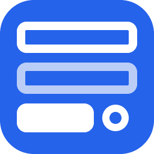

# Loadout (`dsh-loadout`)



> **Loadout** is the plugin. A **kit** is one prepared set of tools. Pick one kit per conversation and carry only the tools that conversation needs.

> **About the name**: `dsh-loadout` on npm is this plugin's only distribution package. Two unrelated GitHub projects share the name — `YongjianWan/dsh-loadout` and `JYDW-1/dsh-loadout` — with different authors and different behaviour. `dsh plugin add dsh-loadout` always installs this plugin; when installing from GitHub, use `JungleYXu/dsh-loadout`.

[中文说明](README.md) · [Changelog](CHANGELOG.md) · MIT

DeepSeek Harness exposes every tool to every conversation: the more plugins you install, the longer the tool list each turn has to carry, and the easier it is for the model to reach for the wrong tool. Loadout groups tools into **kits** and keeps only the current kit's tools visible in that conversation.

## What it does

| Capability | Behaviour |
| --- | --- |
| Three bases | `All` (no masking, default) / `Built-in only` / one of your kits |
| Your kits | Tick built-in tools and plugins under "New kit" and save them as a named loadout. Each card can be set as default, copied as a switch command, edited (overwrite in place, or save as a new kit), annotated, and deleted |
| Add-ons | Attach a plugin on top of the base for a one-off combination, without saving a kit |
| Notes | Up to 20 characters per kit, shown as `Test 1（for video work）` in the menu |
| Token ledger | The menu status line says `saves ~1.9k tokens`; Settings shows the full account (tools kept, tokens kept, tokens saved) |
| Refresh | `⟳` in the menu re-reads the tool catalogue and re-applies the current selection |
| Per conversation | A switch affects only the current conversation, starting with the next message; new conversations start from the default kit in Settings → Loadout |

## Install

Three sources, same package:

```bash
# 1) npm (published)
dsh plugin --profile desktop add dsh-loadout

# 2) GitHub (same package, when the registry is unreachable)
dsh plugin --profile desktop add github:JungleYXu/dsh-loadout

# 3) a local directory (development; installs a link, not a copy)
dsh plugin --profile desktop add link:<absolute path to this directory>
```

Letting Harness install it is the same as the third form:

```text
plugin_manager action=install_bundle target=<absolute path to this directory>
```

Without the dsh CLI you can use `scripts/install.ps1`: it creates the junction link and writes the profile manifest, the same thing `install_bundle` does. Its `-Copy` switch goes back to a copied install — avoid it unless you know why you want one.

Restart the app afterwards: host plugins have no hot reload, and the UI needs at least a refresh.

### Why not copy the files

That is exactly how 0.4.0 broke startup: `install.ps1` copied files into the profile, so after the source was fixed the profile still ran the old bundle. A link cannot drift.

### Self-checks

```bash
node scripts/preflight.mjs    # factory id vs package name, patch row, installed-copy drift
node scripts/selftest.mjs     # host logic: bases, add-ons, saving, store round-trip, masking
node scripts/client-smoke.mjs # browser bundle: menu and settings panel render
```

## Using it

- **Loadout** button in the session header: switch base, attach plugins, create kits.
- **Settings → Loadout**: manage kits, edit notes, choose the new-conversation default.
- `/kit <name>`: switch from the message box.

Settings has no conversation of its own, so it only decides *where new conversations start* — use the header button to change the current one. In the default list, `All` / `Built-in only` and kits are the same kind of card: each can copy its switch command or be set as default. **My kits** starts collapsed and shows only the current default, with the same ＋ New kit action right under it; open it to see the rest. A saved kit can be **edited** on its card: the form opens under that card, and you either overwrite it (conversations already using it switch immediately) or save as a new kit.

### Shipped presets (five, read-only)
Five read-only presets. Editing one forks it into one of your kits.

| Preset | Command id | Built-in tools |
| --- | --- | --- |
| Chat only | `chat` | `ask_user_question` `weather` `web_search` `web_fetch` `read` + collaboration five |
| Coding | `coding` | `pwsh` `read` `write` `edit` `glob` `grep` `todo_write` + collaboration five |
| Research | `research` | `web_search` `web_fetch` `advanced_search` `research` `platform_search` `read` `write` `glob` `grep` + collaboration five |
| Planning | `plan` | `ask_user_question` `web_search` `web_fetch` `read` `write` `edit` `glob` `grep` `todo_write` + collaboration five |
| Writing | `writing` | `read` `write` `edit` `glob` `grep` + collaboration five |

"Collaboration five" = `send_message` `list_agents` `interrupt_agent` `subagent` `subagent_fork`. Every preset carries them, otherwise a subagent switched to that preset cannot even report back.

### Tools for the model

`kit_list` (kits, current binding, how many conversations each kit holds), `kit_apply` (switch this conversation), `kit_assign` (pin a specific conversation), `kit_rename` (display name only), `kit_create` / `kit_set_tools` / `kit_set_default` / `kit_delete` (manage; `kit_delete` accepts `dryRun`). These are kept in every kit, so a kit can never lock the model out of switching back.

## Upgrading

- 0.11.x → 0.12.x: same package name; install over it. The store migrates to `schema: 2` once, with a `loadout.json.v1.bak-<ts>` backup, and every existing conversation is pinned to 全部 so a default change cannot reach back into it.
- 0.4.x → 0.12.x: the package was renamed from `dsh-plugin-kits`; remove the old one first:

  ```text
  plugin_manager action=remove_bundle target=dsh-plugin-kits
  plugin_manager action=install_bundle target=<absolute path to this directory>
  ```

  The old `~/.dsh/plugin-kits.json` is read once and migrated.
- Restart the app after **any** upgrade: host code has no hot reload, and refreshing the UI is not enough.

## Token ledger

The menu status line says `Current: Coding · saves ~1.9k tokens`; Settings shows the full accounting:

```text
This conversation keeps 18 tools · about 1.1k tokens · All is about 3.0k · this kit saves about 1.9k
```

Each kit card also carries its own estimate (`≈1.1k tokens`). The number is an **estimate**: each tool definition (name, description, parameter schema) is serialised and divided by 3.5 characters per token, covering only the tool list — not conversation history, the system prompt, or prompt-cache behaviour. The UI labels it "estimate" for that reason. The kept side is measured from the schemas the runtime actually sends; the "All" side comes from the tool layer's definition table.

## Files

- Kit data: `~/.dsh/loadout.json` (schema-versioned; the older `~/.dsh/plugin-kits.json` is read once, then left behind).
- Uninstall: `plugin_manager action=remove_bundle target=dsh-loadout`.

## Known limits

- Loadout controls only *which tools a conversation can see*. Enabled plugins keep running in the background; UI plugins (sidebars, themes) are unaffected.
- Tools of downloaded-but-not-started plugins cannot be shown: a tool exists only after its plugin's `apply()` runs.
- Masking is subtractive: built-in tools are hidden by a `deny` rule on the tool layer, plugin tools by `tools.restrict({ deny })`. No allow list is ever written, because an allow list as a full replacement is what stripped conversations in 0.7/0.8.
- A fresh install (or a deleted `~/.dsh/loadout.json`) starts on `All`; reinstalling keeps the default you already chose.

## Troubleshooting

**The app will not start: `web boot: … entry did not activate / dsh-loadout: import failed`**

The client bundle failed to register its factory, and the boot audit treats any inactive entry as fatal. In order:

1. `node scripts/preflight.mjs` — it reports whether the bundle's factory id matches the package name. A mismatch is this class of failure.
2. Confirm the install is a **link**, not a copy: `preflight` prints `as a link (no copy to drift)`. If it is a copy, delete `node_modules/dsh-loadout` and `install_bundle` again.
3. Otherwise `remove_bundle`, reinstall, restart. Do not hand-edit `package.json` / `cordis.patch.yml` inside the profile.

**Suspect you installed the other plugin with the same name**

- Check the profile's `package.json`: is `dsh-loadout` a `link:` / `file:`, or a registry version?
- Open `node_modules/dsh-loadout/package.json`; `repository.url` should be `github.com/JungleYXu/dsh-loadout`. If it is not, you installed a different project that shares the name.
- Two same-named packages cannot coexist — both claim the `dsh-loadout` key, and the later install replaces the earlier one. Run `plugin_manager action=remove_bundle target=dsh-loadout`, then reinstall using one of the three sources at the top of this README.

**Installed, but no button / tools unchanged**

- Host code loads on app restart; the browser bundle needs at least a page refresh.
- `GET /dsh-loadout/state` returning JSON means the host is running; 404 means it did not load.
- `⟳` re-reads the tool catalogue without a restart (only for a loaded host).

**Tools vanished after switching**

The allow-list defect from 0.7/0.8 is fixed; masking is deny-only now. If it still happens, click `All` to recover and keep a copy of `/dsh-loadout/debug`.
